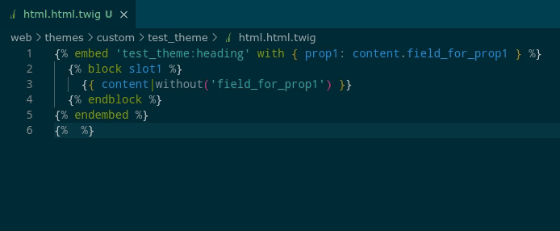

# Drupal SDC Helper

**Enhance your Drupal 10 development workflow with autocomplete and navigation support for projects using Single Directory Components (SDC) approach.**

Developed during Learning Day at [wunder.io](https://wunder.io/).



## Configuration

The extension works by indexing the .twig components within components directories. Make sure to adjust the paths for the directories relative to the workspace (settings).
Index is regenrated when a component (.twig) is saved.

**Example:**

```json
"drupalSDCHelper.componentDirectories": [
  "web/themes/custom/*/components/**",
  "web/modules/custom/*/components/**"
]
```

The defaults assume that the Drupal docroot is `web/` and that components live in custom themes and modules. If your project is set up differently, add your own paths. For example:

- **A different docroot**, such as `docroot/`, `html/` or `src/web/`:

  ```json
  "drupalSDCHelper.componentDirectories": [
    "docroot/themes/custom/*/components/**",
    "docroot/modules/custom/*/components/**"
  ]
  ```

- **Components inside an install profile:**

  ```json
  "drupalSDCHelper.componentDirectories": [
    "web/profiles/contrib/my_profile/themes/custom/*/components/**",
    "web/profiles/contrib/my_profile/modules/*/components/**"
  ]
  ```

- **Any docroot**, using `**/` to match the path in front:

  ```json
  "drupalSDCHelper.componentDirectories": [
    "**/themes/custom/*/components/**",
    "**/modules/custom/*/components/**"
  ],
  "drupalSDCHelper.excludePatterns": [
    "**/vendor/**",
    "**/node_modules/**"
  ]
  ```

  Broad patterns like these search the whole workspace, so use `drupalSDCHelper.excludePatterns` to skip large folders such as `vendor/` and `node_modules/`. By default nothing is excluded.

If no components are found, the extension shows a notification with a shortcut to this setting. The **Drupal SDC** output channel lists the directories that were searched and the components that were found.

## Features

- **Autocomplete Component IDs**: Get suggestions for component IDs while typing `include`, `embed`, or `include` statements in Twig files.
- **Go-to Definition**: Use `Ctrl + Click` to navigate directly to the component's definition file.

## Usage

- Open a Twig file in your Drupal project.
- Start typing an `include` or `embed` statements and autofill options should be presented.
- Press `Enter` to accept a suggestion.
- Hold `Ctrl` and click on a component ID to open its definition file.

## Contributing

Are you interested in improving this extension further? Feel free to contribute by creating a pull request at [Github](https://github.com/wunderio/drupal-sdc-helper).